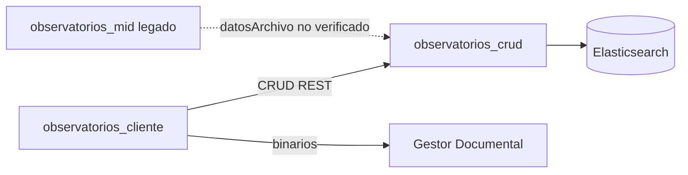

# Arquitectura e integraciones — observatorios_crud

> Estado: resumen histórico consolidado. La vista canónica verificada está en
> [`sdd/arquitectura-as-is.md`](sdd/arquitectura-as-is.md) y la matriz en
> [`sdd/matriz_interacciones.md`](sdd/matriz_interacciones.md).

## Arquitectura del repositorio
- Stack: Django + DRF + Elasticsearch.
- Patrón principal: API REST por apps de dominio con capa común para operación en índices.

## Diagrama de contexto

## Interacciones esperadas
| Sistema origen | Interacción | Resultado |
|---|---|---|
| `observatorios_cliente` | Consumo de endpoints `api/v1` | Operación funcional del módulo observatorios |
| `observatorios_cliente` | Gestor Documental y luego campos/datos en CRUD | Binario separado de metadatos/hash |
| `observatorios_mid` | Código legado hacia `datosArchivo` | [INFERIDO] no operativo con el modelo actual |

## Riesgos técnicos
- Configuración sensible de seguridad y entorno debe endurecerse por ambiente.
- Acoplamiento alto a disponibilidad de Elasticsearch.
- Contratos entre versiones de API y consumidores deben formalizarse.

## Entregables SDD

- [Inventario de endpoints](api/openapi.yaml).
- [Compatibilidad de contratos](api/diferencias-contrato.md).
