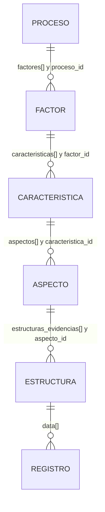

# Modelo de datos e índices AS-IS

## Referencia

[VERIFICADO] Inspección estática de `observatorios_crud@3de996b` el 2026-11-10.
No se consultaron mappings ni documentos de ambientes reales.

## Persistencia

- [VERIFICADO] Los modelos de dominio no heredan de `django.db.models.Model`.
- [VERIFICADO] `ModeloElasticSearch` implementa acceso directo mediante el cliente
  Elasticsearch (`osiris/apps/elasticsearch_utils/models.py`).
- [VERIFICADO] SQLite está configurado para componentes internos de Django, no
  como fuente de verdad del dominio (`osiris/osiris/settings.py: DATABASES`).
- [NO VERIFICADO] Volumen, retención, réplicas, aliases, snapshots y ciclo de vida
  de los índices desplegados.

## Índices

| Índice o patrón | Documento principal | Relaciones observadas | Evidencia |
|---|---|---|---|
| `atlas_observatorios` | nombre, descripción, imagen, `observatorio_id`, activo | Dashboard conserva observatorio como texto | `apps/observatorios/` |
| `atlas_procesos` | datos del proceso, fechas, `orden`, `factores[]`, auditoría | IDs de factores embebidos | `apps/procesos/views.py: PROCESS_INDEX_MAPPING` |
| `atlas_factores` | `proceso_id`, nombre, calificación, `caracteristicas[]`, orden | Padre por ID y lista de hijos | `apps/factores/views.py` |
| `atlas_caracteristicas` | `factor_id`, nombre, descripción, `aspectos[]`, orden | Padre por ID y lista de hijos | `apps/caracteristicas/views.py` |
| `atlas_aspectos` | `caracteristica_id`, nombre, `estructuras_evidencias[]`, orden | Referencias resumidas a estructuras | `apps/aspectos/views.py` |
| `atlas_estructura_<tipo>_<uuid>` | metadatos, `campos[]`, `data[]`, auditoría | `aspecto_id`; un índice por estructura | `apps/estructuras/views.py`; `apps/campos/views.py` |
| `atlas_dashboards` | nombre, descripción, observatorio, columnas | Origina índice dinámico de gráficos | `apps/dashboards/models.py` |
| `atlas_dashboard_<uuid5>` | configuración y posición de gráficos | Referencia textual a estructura | `apps/dashboards/models.py` |

## Jerarquía denormalizada



El diagrama expresa referencias observadas, no claves foráneas. [VERIFICADO] Las
actualizaciones se realizan en operaciones separadas y no tienen transacción
multiíndice.

## Estructura, campos y registros

Campo observado:

```json
{
  "campo_id": "uuid-sintetico",
  "orden": 0,
  "nombre_campo": "Título",
  "tipo_campo": "text",
  "activo": true
}
```

Registro observado:

```json
{
  "valores": {
    "uuid-sintetico": "Ejemplo"
  },
  "activo": true,
  "fecha_creacion": "2026-01-01T00:00:00Z",
  "fecha_modificacion": "2026-01-01T00:00:00Z"
}
```

- [VERIFICADO] El ID HTTP de un registro es su posición actual en `data`; no se
  persiste como identificador estable.
- [VERIFICADO] `DELETE` individual usa `pop`, por lo que cambia posiciones.
- [VERIFICADO] La actualización de campos puede asignar un nuevo `campo_id` al
  cambiar tipo y opcionalmente intentar migrar valores.
- [VERIFICADO] Elasticsearch no permite cambiar en sitio un tipo ya mapeado; el
  código añade mappings para campos nuevos.
- [VERIFICADO] `migrar_data`, `eliminar_data_campos` y validaciones manuales no
  forman un contrato uniforme entre todas las vistas.

## Tipos admitidos

[VERIFICADO] `osiris/apps/campos/utils.py` enumera tipos textuales, numéricos,
booleanos, fechas, geoespaciales, red, compuestos y rangos. La lista expuesta por
`GET /campos/tipos` contiene 30 entradas. La admisión en catálogo no prueba que
todas las conversiones, filtros y visualizaciones funcionen de extremo a extremo.

## Consistencia y borrado

| Recurso | Borrado observado |
|---|---|
| Observatorios, dashboards y gráficos | Lógico; algunas rutas responden 204. |
| Procesos, factores, características y aspectos | Lógico; generalmente 200 y referencias padre no siempre se limpian. |
| Estructura | Marca metadatos y referencia como inactivos. |
| Definición de campos | Vacía `campos` y `data`. |
| Registro embebido | Físico por posición; limpieza de colección vacía todo `data`. |
| `datosArchivo` heredado | Pretende borrado físico, pero su ejecución no está verificada. |

## Serialización y validación

- [VERIFICADO] Los serializers están en `apps/<dominio>/serializers.py`.
- [VERIFICADO] Varias vistas completan o sustituyen validación con acceso manual a
  `request.data`.
- [VERIFICADO] `PUT` es parcial en procesos, factores, características, aspectos y
  estructuras, aunque semánticamente HTTP suele representar reemplazo.
- [VERIFICADO] No hay un esquema de respuesta común para documentos, listas o
  errores.

## Brechas

- [NO VERIFICADO] Versionado y migración formal de mappings.
- [NO VERIFICADO] Políticas de concurrencia, `seq_no`, locks o prevención de
  actualizaciones perdidas.
- [NO VERIFICADO] Integridad periódica entre referencias padre e hijo.
- [PROPUESTA] Cualquier cambio de modelo debe especificar compatibilidad, migración,
  reversión y tratamiento de datos existentes antes de modificar código.
