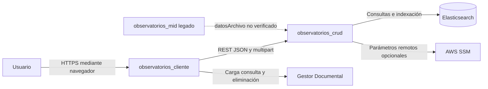
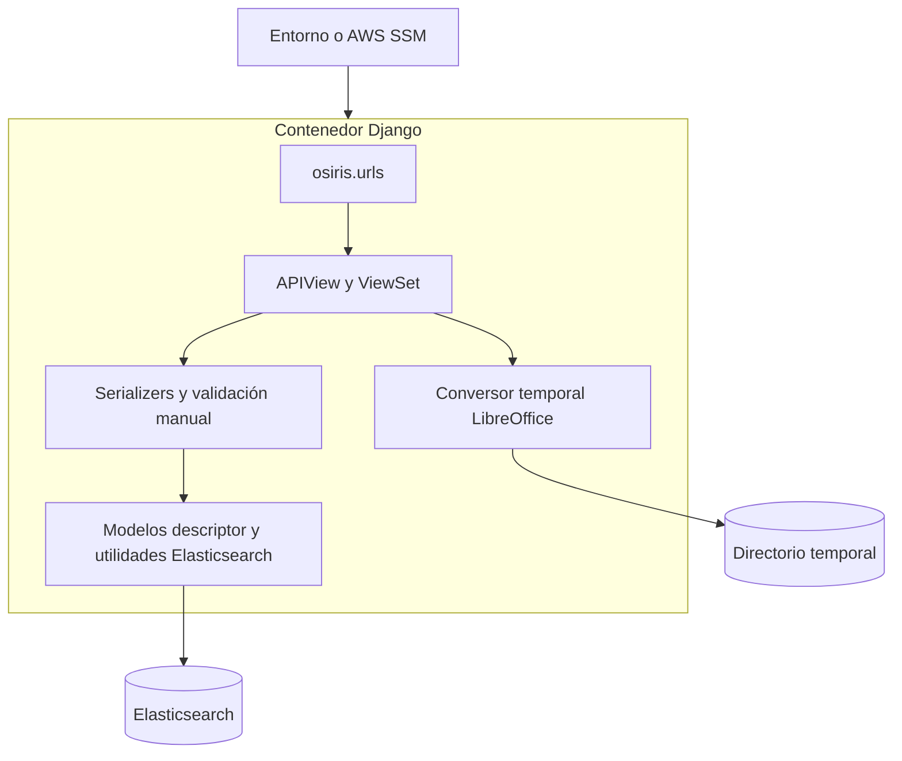
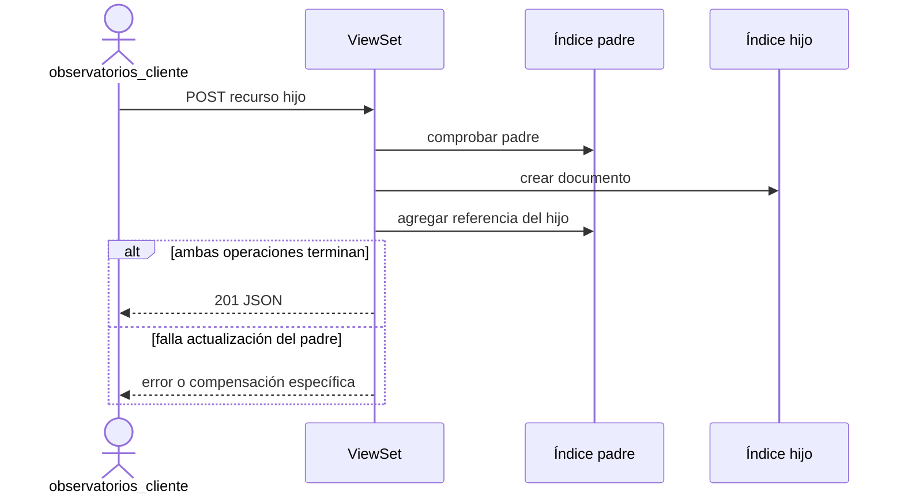
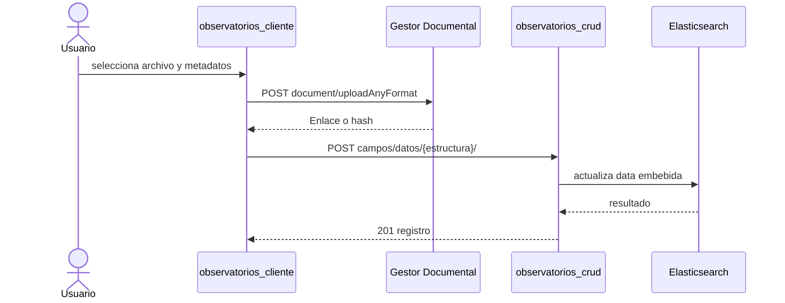

# Arquitectura AS-IS

## Referencia y alcance

Documento inspeccionado contra `observatorios_crud@3de996b166430ca180ab372fbabf69f4c12b419c`
el 2026-11-10. No declara conformidad con ISO/IEC/IEEE 42010 ni con C4; usa
sus conceptos de interesados, preocupaciones y vistas para organizar evidencia.

## Interesados y preocupaciones

| Interesado | Preocupación comprobable |
|---|---|
| Usuario de Observatorios | Consultar y, según la UI, administrar jerarquía, evidencias y paneles. |
| Desarrollador backend | Preservar rutas, payloads, mappings y referencias denormalizadas. |
| Desarrollador frontend | Conocer códigos, errores, paginación y efectos de cada operación. |
| Operación OATI | Configurar Django, Elasticsearch, SSM, Docker y despliegue. |
| Seguridad | Identificar fronteras, validación, permisos efectivos y exposición de errores. |
| Agente de código | Localizar evidencia antes de redactar un cambio TO-BE. |

## Contexto C4

- [VERIFICADO] El cliente consume directamente CRUD y Gestor Documental.
- [VERIFICADO] MID concatena `datosArchivo/...` en
  `observatorios_mid/services/observatorios_service.py`.
- [INFERIDO] La integración MID no es operativa con el modelo actual del CRUD.
- [NO VERIFICADO] Gateway, balanceadores y controles perimetrales no están
  descritos por este checkout.

## Contenedores

| Contenedor/componente | Responsabilidad | Evidencia |
|---|---|---|
| Enrutamiento Django | Prefijo dinámico, health y documentación | `osiris/osiris/urls.py` |
| Views DRF | Orquestación, validación adicional, efectos entre índices | `osiris/apps/*/views.py` |
| Serializers | Forma y validación parcial de entradas | `osiris/apps/*/serializers.py` |
| Modelos/utilidades ES | Mappings, consultas e indexación | `osiris/apps/elasticsearch_utils/`; `osiris/apps/*/models.py` |
| Conversión Office | Valida Word/Excel, ejecuta LibreOffice y retorna PDF temporal | `osiris/apps/campos/views.py: VistaPreviaDocumentoView` |
| SQLite | Soporte interno de Django | `osiris/osiris/settings.py: DATABASES` |

## Límites de confianza

1. Navegador a API: [VERIFICADO] el frontend adjunta Bearer, pero el CRUD no lo
   valida globalmente.
2. API a Elasticsearch: [VERIFICADO] usa credenciales; una construcción del
   cliente desactiva verificación de certificados.
3. API a LibreOffice: [VERIFICADO] archivos no confiables se validan antes de
   conversión y los temporales se eliminan; el semáforo es local al proceso.
4. Entorno a aplicación: [VERIFICADO] configuración local o AWS SSM; no se
   documentan valores secretos.

## Secuencia de jerarquía

[VERIFICADO] No hay una transacción común. Factores intentan compensar la creación;
otras capacidades pueden dejar referencias parciales.

## Secuencia documental activa

[VERIFICADO] El CRUD no guarda el binario en este flujo. [INFERIDO] si la segunda
escritura falla, el archivo puede quedar huérfano.

## Decisiones observadas y limitaciones

- [VERIFICADO] Datos de dominio en Elasticsearch, con índices fijos y dinámicos.
- [VERIFICADO] Relaciones jerárquicas denormalizadas en padre e hijo.
- [VERIFICADO] Registros de estructura embebidos en un único documento.
- [VERIFICADO] Rutas versionadas mediante segmento libre, no mediante routers por
  versión.
- [VERIFICADO] Errores y borrados heterogéneos por capacidad.
- [NO VERIFICADO] No existen ADR que demuestren por qué se eligieron estas
  decisiones; no deben reinterpretarse como recomendaciones TO-BE.

## Correspondencias

- Rutas y operaciones: [`../api/openapi.yaml`](../api/openapi.yaml).
- Datos y mappings: [`../data/modelo-e-indices.md`](../data/modelo-e-indices.md).
- Integraciones: [`matriz_interacciones.md`](matriz_interacciones.md).
- Riesgos: [`brechas-y-riesgos.md`](brechas-y-riesgos.md).
- Operación: [`../operations/ejecucion-y-despliegue.md`](../operations/ejecucion-y-despliegue.md).
