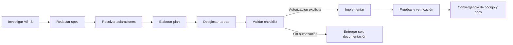

# Flujo Spec-Driven Development

## Lenguaje normativo

En documentos TO-BE, `MUST`, `SHOULD` y `MAY` se interpretan según BCP 14 solo
cuando aparecen en mayúsculas y el documento declara que son normativos. En AS-IS
se prefiere lenguaje descriptivo y etiquetas de evidencia.

## Ciclo

## Puertas

| Fase | Artefacto | Puerta de salida |
|---|---|---|
| Investigación | `research.md` opcional y evidencia | Checkout/commit, actores, contrato y dudas identificados |
| Especificación | `spec.md` | Qué/por qué, alcance, REQ/BR/AC y NFR sin diseñar de más |
| Aclaración | Sección de dudas/decisiones | Ambigüedades críticas resueltas o bloqueo explícito |
| Plan | `plan.md` | Cómo, impactos, datos, seguridad, pruebas y rollback |
| Tareas | `tasks.md` | Orden, dependencias, archivos y validación por tarea |
| Calidad | `checklist.md` | Contrato, trazabilidad, riesgos y compatibilidad revisados |
| Implementación | Código | Solo con autorización; fuera del alcance de una tarea documental |
| Verificación | Evidencias de comandos | Resultados reales, sin ocultar fallos ni pruebas omitidas |
| Convergencia | Docs AS-IS actualizadas | OpenAPI, matrices, spec y operación coinciden con el código |

## Ubicación

Usar `docs/specs/plantillas/` y conservar IDs estables. Los documentos AS-IS
existentes no se reescriben como TO-BE. Una evolución recibe un ID nuevo y enlaza
el requisito que modifica.

## Referencias de calidad

- ISO/IEC/IEEE 29148: requisitos inequívocos, verificables y trazables.
- ISO/IEC/IEEE 42010: interesados, preocupaciones, vistas y correspondencias.
- ISO/IEC 25010: categorías para NFR, sin inventar métricas.
- RFC 9110: semántica HTTP.
- OWASP API Security Top 10 2023: inventario de controles y riesgos.

Estas referencias orientan la documentación; no constituyen certificación.
